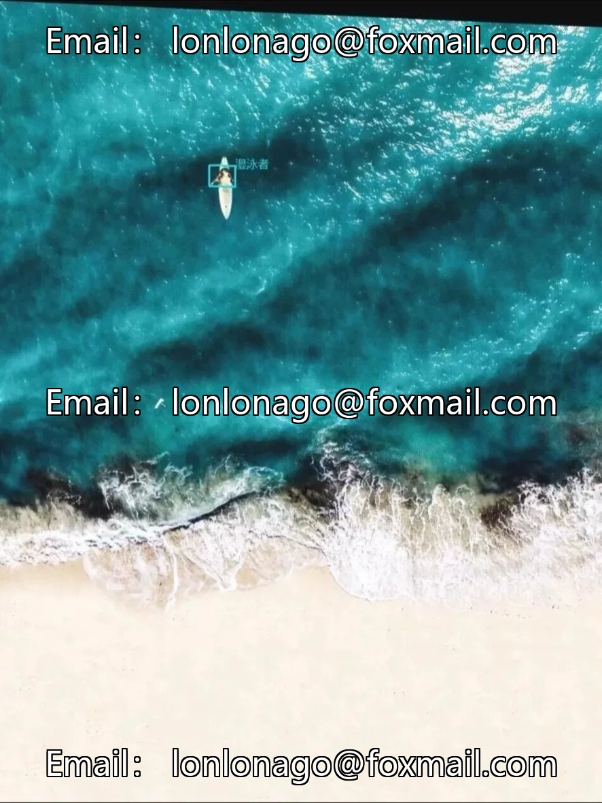
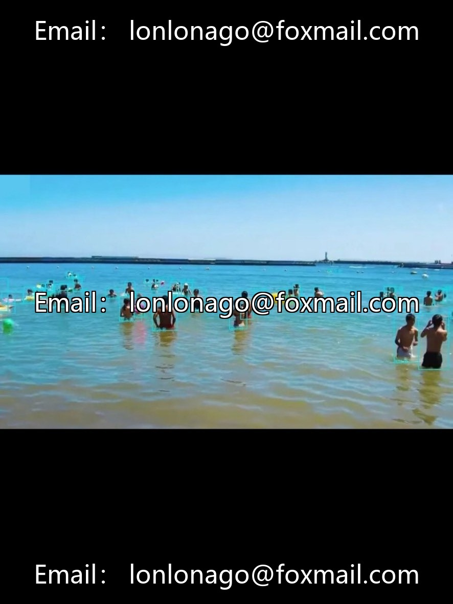
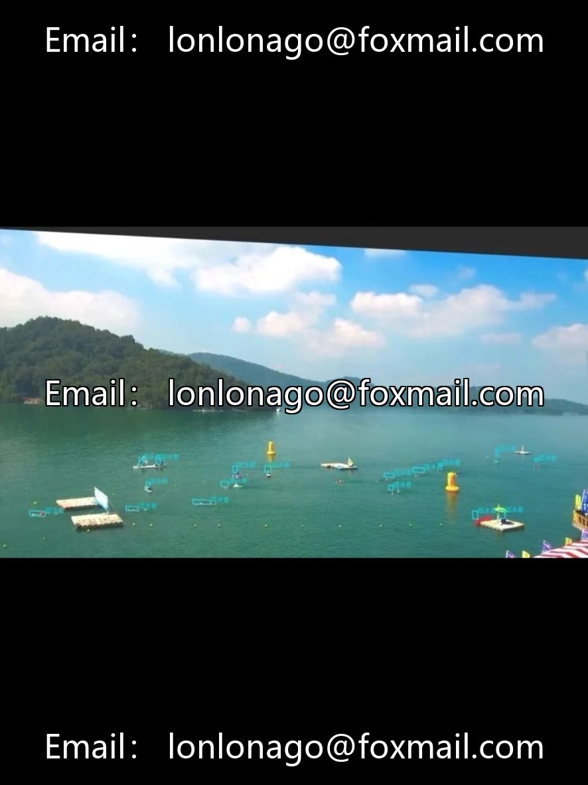
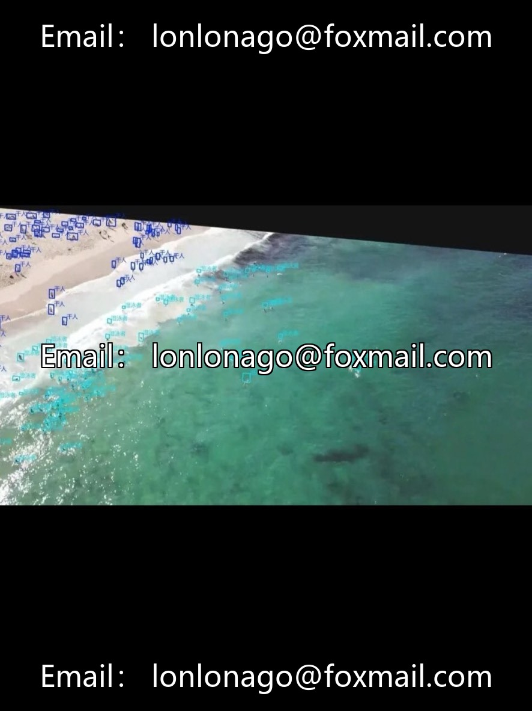

# Drone Beach Small Target Detection Dataset, 1500 High-Resolution Aerial Images, On Land

## Body

Drone Beach Small Object Detection Dataset, 1500 high-resolution aerial images, two types of ground personnel and swimmers annotations, dual formats compatible with YOLO + VOC, supports training of mainstream models such as YOLOv5/v8/v9, Faster R-CNN, RetinaNet.

The dataset covers a variety of weather and lighting conditions, with high target density and extremely small sizes, suitable for research on small object detection algorithms, drone beach security, crowd monitoring, drowning warnings, etc. Bi-format annotation, directly usable, no need for preprocessing.

Virtual materials, once sold, are non-refundable.
Interested friends, click "I want" to proceed.

## Images

## Payment

Here is a pay link on Stripe ( https://buy.stripe.com/3cs8yP7sY87d0vu9AB ). Please contact me lonlonago@foxmail.com after funding $89, and I will send you a complete data files , thank you!

